# bot-creative-toolkit

Headless visual-work tools for AI agents. One setup script installs Blender, Inkscape, GIMP, potrace, FFmpeg,
ImageMagick 7, OpenSCAD, Krita, G'MIC, FontForge and SoX on a Linux box with no screen, and a small CLI, `bct`, turns them into things a bot can drive and, more importantly, **check**.

**Who it's for:** any AI agent or bot that can run shell commands and look at an image: Grok bots, Claude Code,
Codex, Cursor agents, or your own scripts. No GPU or display needed.

**What you get:**

| Tool | What it does |
|---|---|
| `bct look` | Renders a `.blend` file or a `bpy` scene script from four angles into one labelled contact sheet. Optionally runs [model-qa](https://github.com/SnazzyGaz/model-qa) on the model. |
| `bct layers` | Builds images from a JSON layer stack (images, fills, gradients, shapes, text; position, centring, opacity, blend mode, rotation, rounded image corners). Edit one layer and only that layer is redrawn. Writes PNG and layered OpenRaster (`.ora`). |
| `bct vector` | Bitmap to SVG with potrace (one colour or several), draw and edit SVG elements by id, export PNG, PDF or plain SVG with Inkscape (optionally with text turned into outlines). |
| `bct gimp` | Runs GIMP 3 with no window: convert formats (ORA to PSD, XCF to PNG and so on) or run your own GIMP Python. |
| `bct video` | FFmpeg made simple: frames to MP4/GIF/WebM (good-palette GIFs), 360° turntables of any model, exact-frame trims, a contact sheet of a video's frames, and probe. |
| `bct img` | ImageMagick 7 batch jobs: resize (fit, fill, pad), crop (box, trim, circle), icon sets 16–512 px plus `.ico`, montage grids, format conversion, colour adjustments. |
| `bct scad` | OpenSCAD parts to STL with parameters (`-D width=100`), a PNG of the part, a Blender 4-view sheet, and the measured bounding box. |
| `bct fx` | G'MIC artistic filters by name (painting, watercolor, cartoon, sketch, halftone, glow and 15 more), a labelled side-by-side strip to choose from, any of G'MIC's ~430 GUI filters by menu name, or a raw pipeline. Reports how much each filter changed the picture. |
| `bct paint` | Krita with no window: `.kra` ↔ `.ora` ↔ `.psd` ↔ `.png` conversion that keeps layers, layer lists, layered `.kra` from PNGs, and your own Python run inside Krita with the result returned as JSON. |
| `bct font` | FontForge: a font from a folder of SVG letters (e.g. traced drawings), a specimen PNG, TTF/OTF/WOFF/WOFF2 conversion, and what a font contains. |
| `bct audio` | SoX: tones, noise and note-by-note tunes; trim, fade, normalise, join, mix and effects; waveform and spectrogram pictures so a bot can *see* the sound; length and peak levels in every result. |

Every command prints JSON on stdout (paths, sizes, what changed), so an agent can read results instead of guessing.

Contents: [Install](#install) · [Quick start](#quick-start) · [Examples](#examples) · [Tested results](#tested-results-with-vs-without-the-toolkit) ·
[Self-test](#self-test) · [Platform support and limits](#platform-support-and-known-limits) · [More](#more)

## Install

```bash
git clone https://github.com/SnazzyGaz/bot-creative-toolkit && cd bot-creative-toolkit && ./setup.sh && ./selftest.sh
```

- Needs x86_64 Linux, `bash`, `curl` and Python 3.9+.
- `setup.sh` is safe to re-run and skips anything already installed. It tries apt (with sudo) first. If that is not
  available it downloads the official portable builds (Blender 4.2.3, Inkscape 1.4.2 and GIMP 3.0.6 AppImages,
  potrace 1.16, a static FFmpeg, the ImageMagick 7 AppImage, an OpenSCAD development snapshot, the Krita 6 and
  FontForge AppImages, the official G'MIC package for your Debian/Ubuntu release, and SoX from conda-forge) into
  `~/.local/opt/bct` and `~/blender`, linked into `~/.local/bin`.
- Options: `--check` (report only), `--no-gimp` (skip GIMP), `--no-extra` (skip FFmpeg, ImageMagick
  and OpenSCAD), `--no-art` (skip Krita, G'MIC, FontForge and SoX), `--no-krita` (skip only Krita: a 390 MB download,
  1.1 GB unpacked), `--portable` (skip apt).
- If `bct` is not found, add `~/.local/bin` to `PATH`. `bct doctor` shows what is installed.

## Quick start

### 3D: build, look, fix

```bash
bct look examples/scene_example.py -o sheet.png              # front, right, top, three-quarter in one image
bct look scene.py -o sheet.png --qa                          # also run model-qa and report issues in the JSON
bct look scene.py -o close.png --views three_quarter --size 640 --clay
bct look scene.py -o sheet.png --save-blend built.blend      # keep the built scene
```

The sheet header shows object count, triangle count and size in metres, which catches unit mistakes straight away.

### Layered images: change one part without redoing the rest

```bash
bct layers new poster.json --size 1080x1350 --background "#fff"
bct layers add poster.json '{"id":"photo","type":"image","src":"cat.png","x":40,"y":60,"w":1000,"radius":24}'
bct layers add poster.json '{"id":"title","type":"text","text":"Lost cat","y":1150,"size":96,"color":"#111","center":"x"}'
bct layers render poster.json -o poster.png --ora poster.ora

bct layers set poster.json title text="Found cat" --render -o poster.png   # only the title is redrawn
```

Other edits: `replace`, `move`, `hide`/`show`, `reorder`, `remove`. `bct layers from-ora file.ora -o stack.json`
reads a layered file back in.

### Vectors

```bash
bct vector trace logo.png -o logo.svg --threshold 0.5 --despeckle 4     # one colour
bct vector trace art.png -o art.svg --colors 6                          # six colours, stacked light to dark
bct vector new icon.svg --size 256x256
bct vector add icon.svg circle cx=128 cy=128 r=100 fill=#3a7 --id face
bct vector recolor icon.svg --id face --fill "#e63"
bct vector export icon.svg -o icon.png --width 512
bct vector export icon.svg -o icon_final.svg --text-to-path             # plain SVG, text as outlines
```

### GIMP

```bash
bct gimp convert poster.ora poster.psd          # keeps layers
bct gimp script my_edit.py                      # GIMP 3 Python, no window
```

### Video

```bash
bct video turntable examples/rocket.py -o spin.mp4 --gif spin.gif --frames 36 --fps 18 --size 400
bct video encode frames/ -o clip.mp4 --fps 24                 # or 'shots/*.png', or f_%04d.png
bct video encode frames/ -o clip.gif --fps 12 --width 480     # two-pass palette GIF
bct video trim clip.mp4 -o cut.mp4 --start 2 --duration 3     # exact frame count
bct video sheet clip.mp4 -o sheet.png --count 9               # check a video with one image
```

### Batch images

```bash
bct img resize photos/*.jpg --out-dir thumbs --fill 400x300
bct img resize logo.png -o square.png --fit 512x512 --pad --background none
bct img icons mark.svg -o icons --ico favicon.ico             # 16..512 px PNGs + multi-size .ico
bct img crop avatar.png -o round.png --circle
bct img montage shots/*.png -o grid.png --cols 4 --tile 256 --labels
bct img convert big.png -o small.webp --quality 80 --strip
bct img adjust dull.jpg -o better.jpg --auto-level --saturation 115
```

### CAD parts

```bash
bct scad params examples/phone_stand.scad                     # the adjustable sizes and their ranges
bct scad render examples/phone_stand.scad -o stand.stl -D width=100 -D angle=70 --png stand.png --sheet sheet.png
```

### Artistic filters

```bash
bct fx strip photo.png -o choices.png --styles painting,watercolor,cartoon,sketch,halftone,glow   # pick by eye
bct fx apply photo.png -o out.png --style cartoon
bct fx list --search glass                                     # G'MIC GUI filters by name
bct fx gui "Stained Glass" photo.png -o glass.png --set 1=60
bct fx run photo.png -o out.png -- blur 3 sharpen 100            # raw G'MIC
```

### Painting files (Krita)

```bash
bct layers render poster.json -o flat.png --ora poster.ora
bct paint export poster.ora -o poster.kra                      # layered Krita file
bct paint info poster.kra                                      # layer names, opacity, offsets
bct paint export poster.kra -o poster.png
bct paint script edit.py poster.kra out.kra out.png            # your Python inside Krita, result as JSON
```

### Fonts

```bash
bct vector trace letters/A.png -o glyphs/A.svg                 # one SVG per letter: A.svg, b.svg, exclam.svg ...
bct font build glyphs -o MyFont.ttf --name "My Font" --specimen spec.png --text "HELLO"
bct font convert MyFont.ttf -o MyFont.woff2
```

### Sound

```bash
bct audio synth tune.ogg --notes "C5/8 E5/8 G5/4 C5+E5+G5/2" --bpm 140 --wave pluck --reverb 25
bct audio tone beep.wav --freq 880 --dur 0.2
bct audio concat intro.wav tune.ogg -o all.ogg --gap 0.1
bct audio fx all.ogg -o deep.ogg --pitch -300 --echo 0.3
bct audio wave all.ogg -o wave.png && bct audio spectrogram all.ogg -o spec.png   # look at it
```

## Examples

Made with the commands below on a CPU-only box with no screen. The sources are in `examples/`.

### Turntable of a Blender model

```bash
bct video turntable examples/rocket.py -o rocket.mp4 --gif rocket.gif --frames 36 --fps 18 --size 400 --samples 12
```

36 frames rendered and encoded in about 15 s. GIF 400 × 400, 650 KB; the MP4 is 46 KB.

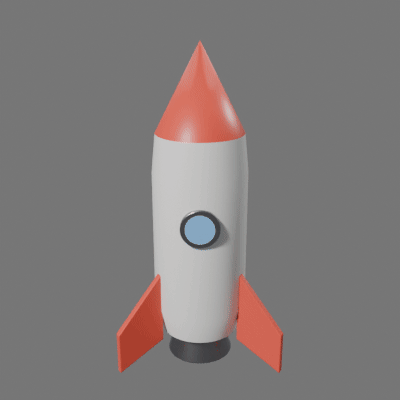

### App icon set from a logo

```bash
inkscape logo.svg --export-type=png --export-filename=logo.png --export-width=2080
bct img crop logo.png -o emblem.png --box 640x640+72+72 --circle      # just the round mark, corners transparent
bct img icons emblem.png -o icons --name northwind --ico favicon.ico   # 16..512 px + .ico (16..256)
bct img montage icons/northwind-{256,128,64,48,32,16}.png -o icons.png --cols 6 --native --labels \
    --label-color "#555" --background "#f5f0e6"
```

The wide "Northwind Pottery" logo from the tests above was cropped to its round mark first: the wordmark is
unreadable at icon sizes. All sizes took about 1 s.

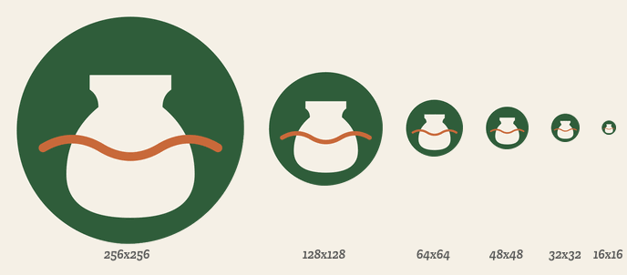

### Parametric phone stand (OpenSCAD)

```bash
bct scad params examples/phone_stand.scad          # width, depth, angle, rest_length, thickness, phone_depth, ...
bct scad render examples/phone_stand.scad -o stand.stl --png stand.png --size 640x480 --sheet stand_sheet.png
bct video turntable stand.stl -o stand.mp4 --gif stand.gif --import-scale 0.001 --frames 30 --fps 15 --size 320 --clay
```

The STL (76 triangles, 80 × 90 × 90.6 mm) and OpenSCAD's picture took 0.1 s; the Blender sheet about 2 s. Any size
can be changed with `-D`, for example `-D width=100 -D angle=70`.

| OpenSCAD's picture | `bct look` sheet of the STL |
|---|---|
| 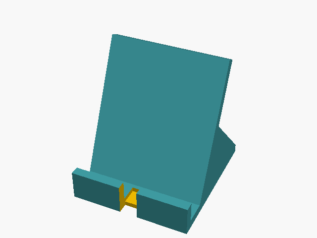 | 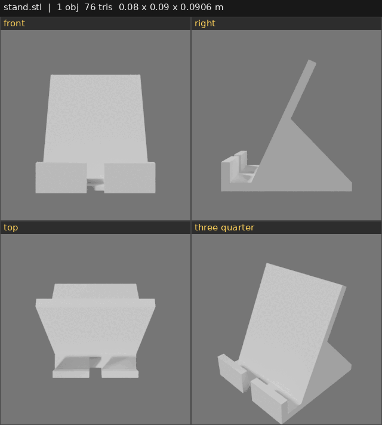 |

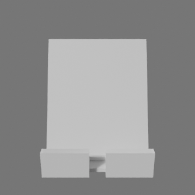

The first version of the stand had the back rest leaning forwards and a wedge on the wrong side. The contact sheet
showed it straight away; the fix was to draw the side profile as one 2D shape and extrude it.

### Seven G'MIC styles on The Great Wave

```bash
bct fx strip wave.png -o fx_strip.png --styles painting,watercolor,cartoon,sketch,halftone,glow,comic --tile 360 --cols 4
```

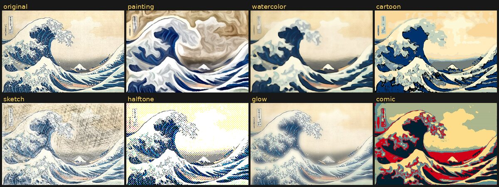

One command, about 2 s for all seven. G'MIC's own painting filter turned the sky bright green in this version, which
the strip showed at once; the `painting` style now uses the same recipe with the bug fixed.

### A display font from hand-drawn letters

`examples/font/draw_letters.py` draws eight wobbly brush-stroke capitals as PNGs; potrace turns each into an SVG and
FontForge builds the font (`examples/font/BotScrawl.ttf`, 5 KB).

```bash
python3 examples/font/draw_letters.py                                    # png/B.png, png/O.png ... png/exclam.png
for f in png/*.png; do bct vector trace "$f" -o "svg/$(basename "$f" .png).svg" --smooth 1.1 --tolerance 0.4; done
bct font build svg -o BotScrawl.ttf --name "Bot Scrawl" --specimen specimen.png --text "ROBOTS BOTS!"
```

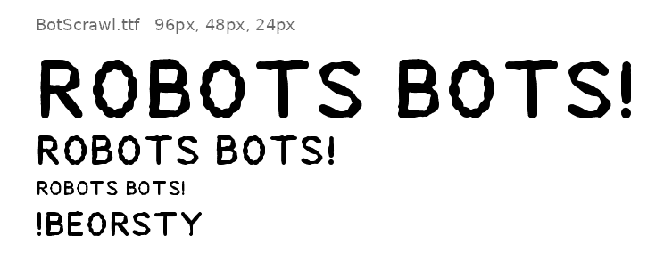

The first build had a huge gap above each line: FontForge treats line-height settings as offsets unless told
otherwise. `bct font` now sets real values.

### A layered poster, opened and edited in Krita

A `bct layers` stack (gradient, the watercolour wave, a multiply-blended panel, a title in the font above) is saved as
OpenRaster, turned into a `.kra`, then edited by a Python script running inside Krita
([`examples/edit_poster.py`](examples/edit_poster.py)): it blurs the picture layer and adds a glowing copy of the
title in a new group.

```bash
bct layers render poster.json -o poster_flat.png --ora poster.ora
bct paint export poster.ora -o poster.kra                  # 5 layers, names, opacity and blend modes kept
bct paint script examples/edit_poster.py $PWD/poster.kra $PWD/poster_edit.kra $PWD/poster_edit.png
bct paint export poster_edit.kra -o poster_edit_cli.png    # not blank: checked in the JSON
```

| Before (`bct layers`) and after (Krita script) |
|---|
| 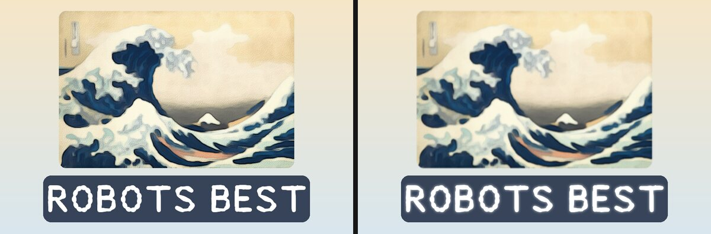 |

### A three-second jingle, seen rather than heard

A rising whoosh (a sine sweep mixed with faded pink noise), then a plucked arpeggio and a chord with reverb.
The sound is [`examples/jingle.ogg`](examples/jingle.ogg) (27 KB).

```bash
bct audio tone whoosh.wav --freq 200 --to 2000 --dur 0.35 --vol 0.25
bct audio noise hiss.wav --color pink --dur 0.35 --vol 0.15 && bct audio fade hiss.wav -o hiss_f.wav --in 0.2 --fade-out 0.15
bct audio mix whoosh.wav hiss_f.wav -o riser.wav
bct audio synth melody.wav --bpm 150 --wave pluck --reverb 25 --notes "C5/8 E5/8 G5/8 C6/8 R/16 G5/16 C6/4 E5+G5+C6/2"
bct audio concat riser.wav melody.wav -o jingle.wav && bct audio norm jingle.wav -o jingle.ogg --db -1
bct audio wave jingle.ogg -o wave.png && bct audio spectrogram jingle.ogg -o spec.png
```

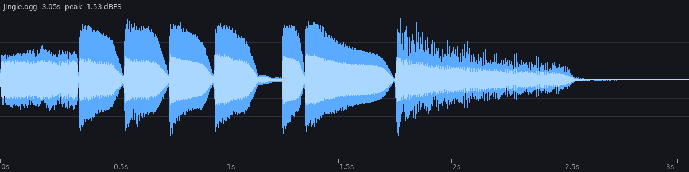
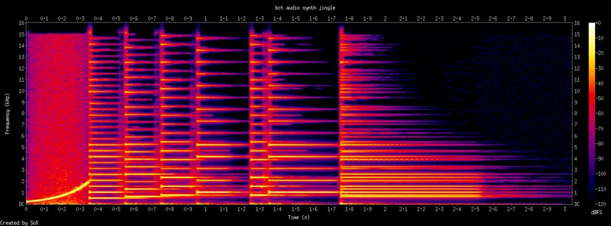

The pictures caught two problems in the first take: the final chord was far quieter than the single notes (each
note was scaled down by the number of notes), and the reverb tail was cut off (padding came after the reverb).
Both are fixed in `bct audio synth`.

## Tested results: with vs without the toolkit

To see whether the toolkit actually helps, four tasks were done twice on the same box on 1 Nov 2026: once
**without** it (plain Python, Pillow, a hand-written SVG and so on) and once **with** it. There was one solid attempt
per side. All numbers below were measured, not estimated. In each image, WITHOUT is on the left and WITH is on the
right.

**Summary:** two clear wins (3D and vectorising) and two ties on the final result, where the toolkit's benefit is the
editing and handover workflow rather than better pixels. The testing also found three missing features and one bug,
which were fixed in 0.1.1 (see [CHANGELOG](CHANGELOG.md)).

| Task | Without | With | Verdict |
|---|---|---|---|
| 3D toy rocket | blind script, one render | `bct look --qa`, two fix rounds | **With wins clearly** |
| Poster, then an edit | Pillow script | `bct layers` stack | Same result; with is easier to edit, about 4× slower |
| Logo | hand-written SVG | `bct vector` | Same result; with is more portable and editable |
| Vectorise The Great Wave | pixel-run rectangles | `bct vector trace` | **With wins** (smooth curves, 2.5 to 4× smaller) |

### 1. 3D object: toy rocket (Blender)

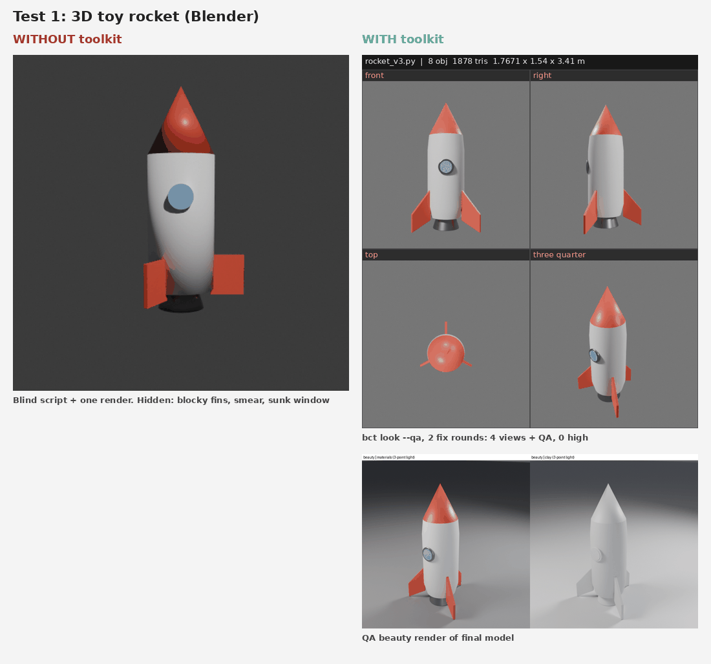

| | Without | With |
|---|---|---|
| Script | 34 lines, plus an 11-line render script | 61 lines after two fix rounds |
| Feedback per try | one image, 0.97 s | four-view sheet plus a model-qa report, 8 to 14 s |
| Problems found | none: it was working blind | v1: 6 medium issues (fins with unapplied scale, asymmetry), smeared shading on body/nose, flat-shaded window, no bevels. v2: 3 high (fins inside out) and fins floating 63.6 mm up |
| Final check | not checked (the same model under model-qa: WARN, 0 high / 6 med) | WARN: 0 high, 3 medium (fin bottoms 3.9 mm above the base, from the bevel), 1,878 triangles |

**Verdict:** the single render without the toolkit looked passable, but the model was worse. It had slab fins, a
smear where the body meets the nose and a sunk window, and nothing showed it. With the toolkit, the four views and the
checker caught every problem, and the fix rounds produced a clean rocket with swept, bevelled fins. Most of the value
is in being able to check the work, not in the render itself.

### 2. Image: layered poster, then change the title and colours

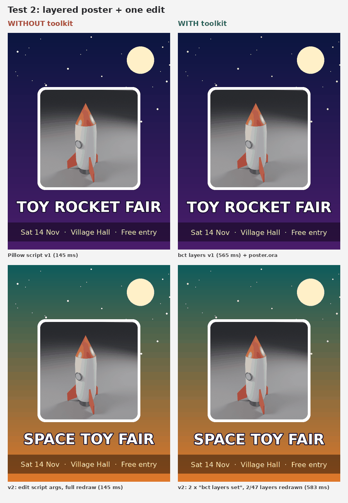

| | Without (Pillow) | With (`bct layers`) |
|---|---|---|
| Work | 33-line script | JSON stack of 47 layers, no code |
| First render | 0.145 s | 0.565 s |
| The edit (new title, new background colours) | change the script arguments and redraw everything: 0.145 s | two `bct layers set` commands: 0.583 s, only 2 of 47 layers redrawn, 45 from cache |
| Untouched parts after the edit | rocket and frame unchanged (max pixel diff 0) | rocket and frame unchanged (max pixel diff 0) |
| Output | PNG | PNG plus a layered `.ora` that opens in GIMP and Krita |

**Verdict:** a tie on the result. The two posters match (mean pixel difference 1.23 out of 255). The toolkit makes
edits a one-line command with no code and gives a person a layered file to work with, but for a tiny one-off image
it is about 4× slower than a bare script. The first attempt with the toolkit had an off-centre title and square
image corners because the stack could not centre layers or round corners. Both were added in 0.1.1.

### 3. Logo: "Northwind Pottery"

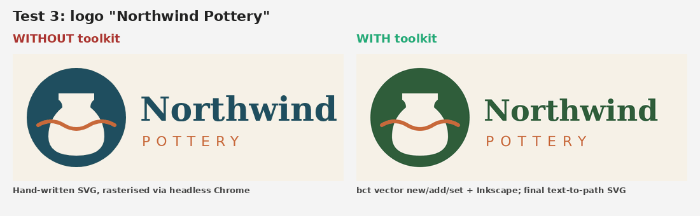

| | Without | With (`bct vector`) |
|---|---|---|
| Build | hand-written SVG, 689 bytes | `new` plus 5 `add` commands, 795 bytes |
| Turning it into a PNG | headless Chrome, 1.8 s (only works because Chrome happened to be installed) | Inkscape, 1.17 s including the build |
| Edit (recolour, letter spacing) | `sed`, 0.49 s | `recolor` and `set` by id, 0.39 s |
| File to hand over | live text (needs the font) | outlined SVG, 6.8 KB, no `<text>` left |

**Verdict:** a tie on the result. The two renders match (mean pixel difference 0.39 out of 255), and the design
needed the same tweak either way (the name was shrunk to fit). The image shows the without version and the final
recoloured version made with the toolkit. The toolkit did not make a better logo. What it adds is a renderer that
does not depend on a browser, edits by element id, and a font-safe export.

### 4. Vectorise a complex image: The Great Wave off Kanagawa

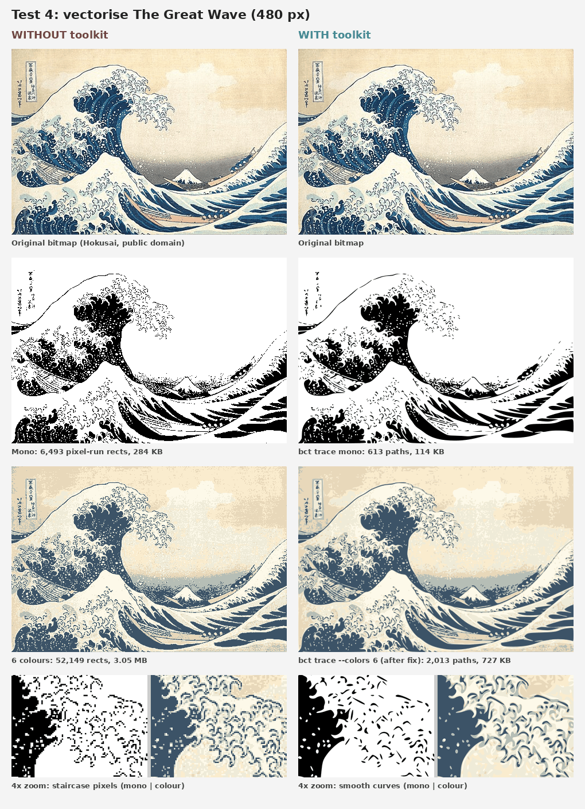

Source: *The Great Wave off Kanagawa* by Katsushika Hokusai (about 1831), public domain, from
[Wikimedia Commons](https://commons.wikimedia.org/wiki/File:Tsunami_by_hokusai_19th_century.jpg), scaled to 480 × 323.
"Without" writes one `<rect>` per horizontal run of same-colour pixels. "With" uses `bct vector trace`. Every SVG
was turned back into a PNG with Inkscape and compared to the original. MAD is mean absolute pixel difference (lower
is better) and SSIM is structural similarity (higher is better).

| Variant | SVG size | Elements | Points | Fidelity | Time |
|---|---|---|---|---|---|
| Without, one colour | 284 KB | 6,493 rects | 25,968 | matches 100% of the black/white mask; SSIM 0.655 vs greyscale | 72 ms |
| With, one colour | 114 KB | 613 paths | 15,091 | matches 97.0% of the mask; SSIM 0.641 vs greyscale | 105 ms |
| Without, six colours | 3.05 MB | 52,149 rects | 208,596 | MAD 13.1, SSIM 0.824 | 233 ms |
| With, six colours (0.1.0, before the fix) | 721 KB | 4,006 paths | 96,469 | MAD 26.2, SSIM 0.453 | 241 ms |
| With, six colours (0.1.1) | 727 KB | 2,013 paths | 105,453 | MAD 15.5, SSIM 0.749 | 282 ms |

**Verdict:** the toolkit wins. The rectangle SVGs score as perfect copies of the reduced-colour bitmap because they
*are* that bitmap, written out as rectangles. Zoomed in they show staircase edges, and they are 2.5 to 4× bigger.
potrace gives real curves that stay smooth at any size, at a small cost in pixel accuracy. This test also found a bug
in 0.1.0's colour mode: colours were traced separately over the most common colour, so dark seams showed through the
gaps. 0.1.1 uses the lightest colour as the background and stacks the rest light to dark, which halved the error.

### Toolkit gaps found during testing

- Fixed in 0.1.1: centring layers, rounded image corners, `--text-to-path` export, and the multi-colour trace seams.
- Still open: `bct look` frames the subject loosely (it sits small in each tile), and the top view is of little use
  for tall objects.
- Still open: `bct layers` is about 4× slower than a bare Pillow script for tiny one-off images.
- Note: model-qa flags a 3.9 mm gap left by a bevel as "near ground", which is borderline noise.

## Self-test

`./selftest.sh` runs 89 end-to-end checks and exits non-zero if any fail. The last run took about 38 s on a CPU-only
box, not counting first-time downloads (and Krita's 30 s first start).

- **setup (1):** every program is installed (`setup.sh --check`).
- **look (6):** a `.py` scene becomes a 2×2 contact sheet that is not blank; a `.blend` input works with the
  workbench engine; a bad view name is rejected; `--qa` runs model-qa and writes a report (skipped if model-qa is not
  installed).
- **layers (8):**
  - a stack with all 7 layer types, blend modes and opacity renders to PNG and ORA, and the pixels are checked;
  - the ORA file is valid;
  - a second render redraws nothing;
  - replacing one image redraws only that layer;
  - move, hide, set, reorder, add and remove all show up;
  - ORA → JSON → the same picture.
- **gimp (2):** GIMP opens the ORA and exports a matching flat PNG; ORA → layered PSD.
- **vector (8):**
  - a one-colour trace drops the specks;
  - a three-colour trace makes one group per colour;
  - new, add, set, recolor and delete all show up in `list`;
  - Inkscape export comes out at the requested width with the right pixels;
  - traced SVGs export too.
- **video (11):**
  - 30 odd-sized frames become an H.264 MP4 that ffprobe reports as 30 frames, 2.0 s, even size, `yuv420p`;
  - a printf pattern becomes a 120 px GIF that keeps all 30 frames;
  - trims of MP4 and GIF give exactly 15 frames for 1 s;
  - the frame sheet has the right layout and is not blank;
  - an 8-frame turntable gives an MP4 and a GIF of 8 frames each, and the frames differ.
- **img (11):** fit + pad and fill give exact sizes; an icon set has every size 16–512 and the `.ico` holds 16–256
  with transparent corners; a montage has the right grid size; PNG converts to WebP and JPEG; `--circle` clears the
  corners; saturation 0 gives grey.
- **scad (8):** parameters are listed; the phone stand with `-D width=100 -D depth=110` gives a non-empty STL whose
  re-measured box is 100 × 110 mm and matches OpenSCAD's own; the PNG is the right size and not blank; string
  parameters and `echo()` come through; a 2D-only model is refused; the Blender sheet of the STL measures 8 cm.
- **fx (14):** six styles each change the pixels and keep the size; sketch is grey and cartoon keeps colour; a strip
  has the right number of tiles; a raw pipeline works; a bad style is refused; a GUI filter runs by name with its
  defaults; the filter list has hundreds of entries.
- **font (5):** four SVG glyphs become a TTF with exactly those characters plus space; rendered with Pillow, `I` is
  narrow, `O` is wide with a hole and `.` sits on the baseline; WOFF2 and OTF conversion read back; the specimen
  reports a missing letter.
- **audio (8):** a 440 Hz tone has the right length, peak and pitch (FFT); a tune at 120 bpm is exactly 2.0 s with a
  silent rest and no clipping; noise, mix, gap-joined concat (1.25 s), fade (starts from silence) and normalise
  (-1 dBFS) are right; pitch shift keeps the length; waveform and spectrogram PNGs are the right size and not blank.
- **paint (7):** ORA → KRA keeps layer names and opacity; KRA → PNG matches the `bct layers` render within 3/255;
  PNGs stack into a KRA; a Python script inside Krita adds a layer and returns its result and print output; KRA →
  PNG works without Krita.

## Platform support and known limits

- **Tested on:** x86_64 Debian-based Linux with no display or GPU, using the portable builds (apt was not available).
  The CLI is Python 3 and bash.
- **Not supported:** ARM Linux, macOS and Windows. The portable downloads are x86_64 Linux builds. On other systems,
  installing Blender, Inkscape, GIMP and potrace yourself may work, but this is untested.
- **Rendering is CPU only.** Cycles at the default small size takes a few seconds per sheet. Eevee is slow without a
  GPU.
- **GIMP is slow to start,** a few seconds per call, so batch work into one script. GIMP is the biggest download;
  skip it with `--no-gimp` if you don't need PSD or XCF.
- **The 3D checks** (`--qa`) need [model-qa](https://github.com/SnazzyGaz/model-qa), installed separately. Without it,
  `bct look` still works and reports the check as skipped.
- **OpenSCAD** comes from the development snapshots, because the last stable release (2021.01) has no fast Manifold
  backend. If the snapshot server is down, setup falls back to 2021.01, which works but renders much more slowly.
- **Turntables** render every frame in Cycles on the CPU: 36 frames at 400 px took about 15 s for the rocket.
- **Krita** is big (1.1 GB unpacked), needs an X server (setup installs Xvfb; `bct paint` uses it automatically),
  and takes about 30 s the first time. Scripts can't paint brush strokes.
- **G'MIC's portable install** uses the official `.deb` for your release, so it only works on Debian and Ubuntu
  (or wherever `gmic` is already on PATH or in the package manager).
- **Fonts** have no kerning and no hinting unless you ask (`--hint`). Good for display text, not for body text.
- **Text** in layers and SVGs uses whatever fonts the box has (DejaVu in the tests). Use `--text-to-path` before
  handing an SVG to someone else.

## More

- [AGENTS.md](AGENTS.md): step-by-step instructions written for AI agents (read this first if you are one).
- [CHANGELOG.md](CHANGELOG.md): what changed in each version.
- `bct help` and `bct <tool> --help` give the full options.

## Licence

MIT. Copyright (c) 2026 Garyck Arntzen. The Great Wave image in `docs/images/compare_vector.png` is in the public
domain.
